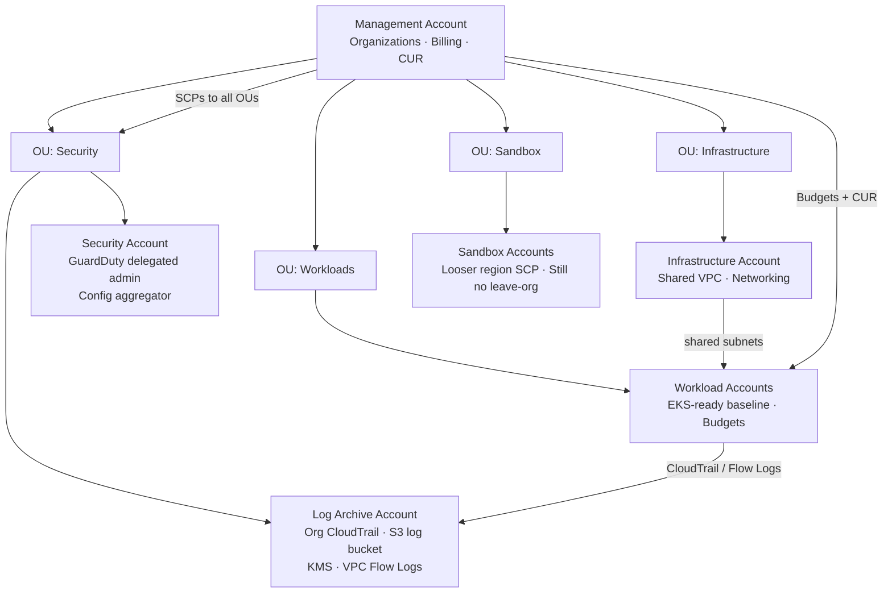

# AWS Landing Zone — Terraform Reference Implementation

A multi-account AWS landing zone in Terraform: organization structure,
service control policies, centralized audit logging, IAM permission
boundaries, a shared three-tier VPC shaped for EKS, workload-account
guardrails, and cost controls as code — plus an Ansible EC2 host
baseline for the configuration layer Terraform does not own.

> **Honest framing:** this is a *reference implementation* demonstrating
> production patterns the author has genuinely run in regulated
> environments. It is not a claim that this exact code ran at any
> specific employer. Account IDs, emails, and bucket names are fake
> examples throughout. Outcomes below are stated as design goals and
> properties of the implementation, not measured production results.

## Problem

A single AWS account does not stay single for long. Without an account
strategy, teams share one blast radius, one audit trail that workload
admins can edit, one undifferentiated bill, and guardrails that exist
only as wiki pages. A landing zone solves that structurally — before
the first workload lands:

- **Isolation by account**, so a compromise or a runaway experiment is
  contained.
- **Guardrails that cannot be talked around** (SCPs and boundaries),
  instead of conventions.
- **Audit evidence in an account the workload cannot touch.**
- **Cost visible from day one**, allocated by tag and account.

## Architecture



### Modules

| Module | What it owns |
|---|---|
| `modules/organization` | Organization, four OUs, opt-in account creation, four SCPs (deny leave-org, protect audit trails, restrict regions, require encryption) |
| `modules/logging` | Organization CloudTrail to a KMS-encrypted central S3 bucket, Config aggregator, GuardDuty detector in the delegated-admin pattern |
| `modules/iam-baseline` | Workload permissions boundary, MFA-gated break-glass admin role, standard workload role, deny-non-TLS policy |
| `modules/networking` | Three-tier VPC (public / private / data) across 3 AZs, per-AZ NAT, VPC endpoints for S3/ECR, flow logs to the log account, EKS-shaped subnet outputs |
| `modules/workload-baseline` | EBS encryption by default, IMDSv2 account defaults, S3 account public-access block, Config recorder, DB subnet group, per-workload budget |
| `modules/cost-guardrails` | Monthly budget (50/80/100% actual + 100% forecast), SNS cost-alert topic, CUR bucket and report definition |
| `ansible/` | EC2 host baseline role: sshd hardening, auditd rules, sysctl, package floor, SSM-first posture |

## Key decisions and tradeoffs

**SCPs are guardrails, not grants.** SCPs only cap permissions; they
are paired here with IAM boundaries *inside* accounts (see Interview
notes). Attaching the same baseline SCPs to every OU keeps the mental
model simple: no account, however trusted, can leave the org, kill its
trail, or create unencrypted volumes.

**The region SCP is the one people break.** Global services (IAM,
Organizations, Route 53, CloudFront, STS, Budgets, Cost Explorer) must
be allow-listed via `NotAction`, or the policy denies the control
plane itself. The implementation does this explicitly and comments why.

**Sandbox gets a documented exception, not a silent one.** The region
restriction is not attached to the Sandbox OU in this reference — a
deliberate tradeoff favoring experimentation, recorded in code. A
stricter environment should attach it; a laxer one should be honest
that it chose not to.

**Log archive is a separate account on purpose.** If trails land in
the workload account, a workload admin can rewrite history. Centralizing
in an account with no workloads, versioned and KMS-encrypted, with a
bucket policy scoped to the organization ID, makes the audit trail
evidence rather than decoration.

**Data subnets have no internet route at all.** Not "no inbound" —
no default route. Databases and caches are reached in-VPC or through
endpoints. That removes a whole class of misconfiguration.

**NAT: one per AZ by default, one total if you ask.** Per-AZ NAT is
the resilient choice and the expensive one. The flag exists, defaults
to resilience, and the cost tension is named in the FinOps section
rather than hidden.

**VPC endpoints are a cost control, not just security.** Gateway S3
and interface ECR endpoints keep high-volume traffic off NAT gateways,
which charge per gigabyte processed.

**Account creation is behind a flag.** Creating an AWS account is
slow and effectively irreversible. `create_accounts = false` lets the
guardrail half of the module be planned and reviewed against an
existing organization without provisioning anything.

## FinOps quick wins

Framed as operating practices this implementation *enables* — no
savings figures are claimed, because honest FinOps starts with
measurement, not promises.

- **Cost guardrails in code (`modules/cost-guardrails`).** Every
  workload gets a budget at creation, with actual alerts at 50/80/100%
  and a *forecast* alert at 100% — the forecast alert is the one that
  arrives while there is still time to act. Alerts fan out through SNS
  so they can reach email today and chat/automation tomorrow.
- **Tagging for cost allocation.** `CostCenter`, `Environment`,
  `Owner`, and `Project` are threaded through every module. Activate
  those keys as cost allocation tags in the payer account and enforce
  presence with a Config `required-tags` rule; then CUR + Athena (the
  CUR definition here emits the Athena artifact) can answer "what does
  this project cost?" without a spreadsheet archaeology project.
- **Idle-resource cleanup cadence.** A weekly review driven by CUR /
  Trusted Advisor data: unattached EBS volumes, idle NAT gateways in
  non-production accounts, old snapshots, and stopped-but-stored
  instances. Automation should *report and ticket* first; deletion
  follows an owner-confirm window.
- **Rightsizing cadence.** Monthly review of Compute Optimizer /
  CloudWatch utilization for EC2 and RDS; EKS node groups sized from
  actual requests vs. usage (e.g., with VPA in report mode). Rightsizing
  is a rhythm, not a one-off project — instances drift back.
- **Savings Plans / RI review rhythm.** Quarterly: check coverage and
  utilization before buying more commitment, prefer convertible and
  compute Savings Plans for changing fleets, and never commit past
  what the *stable baseline* of usage supports. Commitment is the last
  optimization, after cleanup and rightsizing shrink the baseline.
- **Architectural savings already in the code.** S3 gateway endpoints
  (free) instead of NAT-processed S3 traffic; log lifecycle to
  Glacier Instant Retrieval at 90 days; the `single_nat_gateway` flag
  for sandbox/non-production VPCs where AZ resilience is not worth
  three NAT gateways.
- **Sandbox hygiene.** Sandbox accounts get the smallest default
  budget limit and the same audit SCPs — experimentation is welcome,
  surprise bills and silent trails are not.

## How to run / deploy

Prerequisites: Terraform >= 1.5, AWS credentials for the management
account (for the organization module) and for each target account,
with providers aliased per account in a real deployment.

```bash
# Validate the full composition without touching AWS
cd examples/complete
cp terraform.tfvars.example terraform.tfvars
terraform init -backend=false
terraform validate
terraform fmt -check -recursive ../..
```

Reading order for a real rollout:

1. Apply `modules/organization` from the management account. Decide
   `create_accounts` explicitly.
2. Apply `modules/logging` in the log archive account; delegate
   GuardDuty / Security Hub administration to the security account.
3. Apply `modules/networking` in the infrastructure (or workload)
   account; note the private subnet outputs.
4. Apply `modules/iam-baseline` and `modules/workload-baseline` per
   workload account, feeding in the networking outputs.
5. Apply `modules/cost-guardrails` in the payer account (CUR report
   definitions are always created in `us-east-1`).
6. Run the Ansible baseline for EC2 fleets:

   ```bash
   cd ansible
   ansible-playbook -i inventory/hosts.yml playbooks/site.yml --check
   ```

Compliance context: the patterns align with control families commonly
mapped to STIG / SRG baselines and CMMC 2.0 practices (audit logging,
least privilege, encryption at rest, configuration baselines). The
code makes no certification claim — it implements the technical
controls those frameworks ask for.

## What it demonstrates

- Multi-account AWS architecture and OU/account strategy
- SCP and permissions-boundary design (org-wide vs. in-account guardrails)
- Centralized, tamper-resistant audit logging (CloudTrail, Config, GuardDuty, flow logs)
- Modular, composable Terraform with per-module interfaces and a validating example root
- Network design for Kubernetes: subnet tagging, isolated data tier, endpoint strategy
- FinOps as code: budgets, forecast alerting, CUR, tagging for allocation
- Configuration management with Ansible alongside IaC, with an SSM-first posture
- Security defaults that fail closed: IMDSv2, EBS encryption by default, default SG deny

## Repository layout

```
.
├── modules/
│   ├── organization/        # Org, OUs, SCPs, opt-in accounts
│   ├── logging/             # Trail, log bucket, aggregator, GuardDuty
│   ├── iam-baseline/        # Boundary, break-glass, workload roles
│   ├── networking/          # Three-tier VPC, NAT, endpoints, flow logs
│   ├── workload-baseline/   # Account floor + EKS-ready consumption
│   └── cost-guardrails/     # Budgets, SNS alerts, CUR
├── examples/complete/       # Single-root composition, fake values only
└── ansible/                 # EC2 host baseline role + sample inventory
```

## Interview notes

*Talk-track guidance for walking through this repo — design reasoning,
not a script to memorize.*

**Account strategy tradeoffs.** "I separate by blast radius and by
function: security tooling and logs get their own accounts so workload
admins can't touch the evidence; workloads get an account per
environment/team boundary that matters; sandbox is isolated so
experimentation can't become an incident. The cost is operational —
more accounts means more baseline to automate — which is exactly why
the baseline is code. If everything is one `terraform apply` per
account, the marginal account is cheap."

**Why SCPs *and* IAM boundaries?** "They operate at different layers
and fail differently. An SCP caps an entire account from the org
level — even the account root can't exceed it — but it's coarse and
applies to everyone, including roles you might want exempt. A
permissions boundary caps a *role* inside the account and travels with
the role, so a developer can create their own roles without being able
to create one stronger than the boundary. SCPs answer 'what can this
account never do?'; boundaries answer 'what can this identity never
become?' You want both answers written down."

**Blast-radius reasoning.** "Every structural choice here is about
containing failure: separate log account contains audit tampering,
data subnets with no route contain a misconfigured security group,
per-workload budgets contain a runaway job to a loud alert instead of
a quiet month-end surprise, break-glass with MFA and a one-hour
session contains standing privilege to actual incidents. I ask of
each resource: if this is compromised or just misconfigured at 2 a.m.,
what's the furthest the damage reaches — and I try to make the answer
boring."

**Other honest answers to expect.** The region SCP's global-service
exceptions and the CUR-in-us-east-1 gotcha are called out in code
comments because both are mistakes I have seen (and prefer to design
out). Account vending at scale would move to a factory pattern
(Control Tower / AFT-style) — this module is the hand-rolled version
that teaches what the factory automates.

## License

MIT — see [LICENSE](LICENSE).
